# 项目复现

我们让一艘水面艇和五艘水下航行器在二维仿真中分工完成任务，比较不同规划方法，并用 MOOS 和 VRX 验证单艇任务能否执行并回报完成。

## 1、流程框架


项目分成两条线推进：**二维主实验**研究路径、分配与动态执行；**平台支线**分别检查 MOOS 和 VRX 的单艇接口（两条线各自保存证据，目前没有将完整的 1 USV＋5 UUV 协同过程迁入平台）

## 2、项目结构

```text
usv-uuv-cooperative-planning-reproduction/
├── README.md                         # 项目说明、成果与运行入口
├── usv_uuc_cooperation/
│   ├── main.py                       # 统一命令行入口
│   ├── config.py                     # 路径、场景目录与输出位置
│   ├── configs/                      # 固定场景、算法和平台参数
│   ├── agents/                       # USV／UUV状态与参数
│   ├── env/                          # 网格地图、障碍、洋流与几何通信
│   ├── planning/                     # A*、Dijkstra、D*、扫描与PSO路径搜索
│   ├── scheduling/                   # 贪心、OR-Tools、Pyomo与动态分配
│   ├── control/                      # 移动、服务、预算及动态执行
│   ├── experiments/                  # 各类实验与MOOS／VRX运行入口
│   ├── metrics/                      # 指标统计、结果记录与检查
│   └── visualization/                # 从本次运行日志生成图与动画
├── data/
│   ├── inputs/                       # 代码运行必需的固定输入
│   └── provenance/                   # 源码校验、实验目录与VRX资产身份
├── results/                          # 成果图／动画与最终指标
│   ├── p1_pathfinding/               # 地图与A*三场景
│   ├── p2_assignment/                # 分配与多任务路线
│   ├── p3_baseline/                  # 协同成功／预算受限失败
│   ├── p4_dynamic/                   # 固定归属／动态接手
│   ├── x1_adjacency/                 # 四／八邻接比较
│   ├── x2_algorithms/                # 六种路径方法比较
│   └── p5_platforms/                 # MOOS／VRX指标与实际仿真图
├── docs/
│   ├── assets/                       # 流程框架图
│   └── vrx_environment.md            # VRX环境与运行步骤
├── tools/                            # 文件校验与VRX运行辅助
└── requirements/                     # Python与独立求解环境依赖
```

UUC为历史包名，正式平台称谓为USV／UUV。GitHub保存运行代码、必要输入和最终成果；课堂记录、原始运行日志、过程核查与交付材料在本地保存。新运行的 `runs/`、`showcase/`、`checks/` 默认不提交。

## 3、学习路线

1. **地图与安全路径：**网格建图、安全缓冲、A*及四／八邻接。
2. **分配与访问顺序：**区分任务归属、起点分配成本与完整路线目标。
3. **协同执行：**把移动、到达、服务、中继和预算放到同一时间轴。
4. **动态响应：**处理洋流、新任务、临时禁行和故障后的剩余任务接手。
5. **方法比较：**在共同案例与统计口径下比较六种路径方案。
6. **平台运行：**检查目标发布、实际位姿和同任务完成反馈，再理解二维与VRX的时间差异。

## 4、实验拆解

| 实验 | 核心问题与对照 | 结果入口 |
|---|---|---|
| P1 地图与路径 | 障碍增加后如何绕行？不可达时返回什么？ | [A*三场景](results/p1_pathfinding/README.md) |
| P2 分配与排序 | 最近分配是否也让完整路线最好？对照贪心、枚举与CP-SAT | [小案例与反例](results/p2_assignment/README.md) |
| P3 协同基线 | 服务和预算能否满足？正常预算对照仅U3预算受限 | [成功／受限失败](results/p3_baseline/README.md) |
| P4 动态事件 | 相同初始分配、流场和事件下，固定归属与动态接手有何差别？ | [静态／动态](results/p4_dynamic/README.md) |
| X1／X2 方法比较 | 邻接和路径方法如何影响完整执行？ | [四／八邻接](results/x1_adjacency/README.md) · [六种方法](results/x2_algorithms/README.md) |
| P5 平台接口 | 目标发布后能否读回位姿、正确判断完成或失败？ | [MOOS／VRX](results/p5_platforms/README.md) |

动态案例含20个初始任务、t11新增2任务；X2另有t6禁行、t18撤销、t24的U4故障。通信为距离阈值评价，NEU为几何移动代理，动态分配为集中式事件触发机制。模型边界：尚未验证真实水声、物理电池功耗、水下六自由度、多艇平台联动或实艇性能。

## 5、复现结果

以下直接展示保存运行的图、动画和指标；每组末尾提供原始数据入口。

### 5.1 地图避障与任务路线：先看计划是否合理

**A* 三场景：**同一规则下，基准路径为 6 m；增加障碍后绕行为 14 m；不可达时返回空路径。图中可以直接检查障碍、安全缓冲与搜索路线的关系。

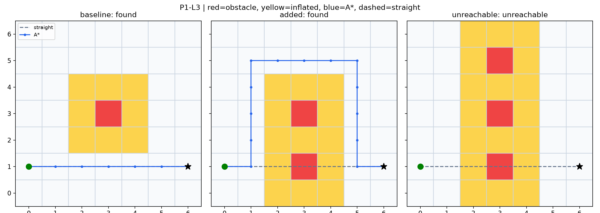

**两艇四任务：**同时查看任务归属、访问顺序和连接路径；分配成本与完整路线长度分别计算。

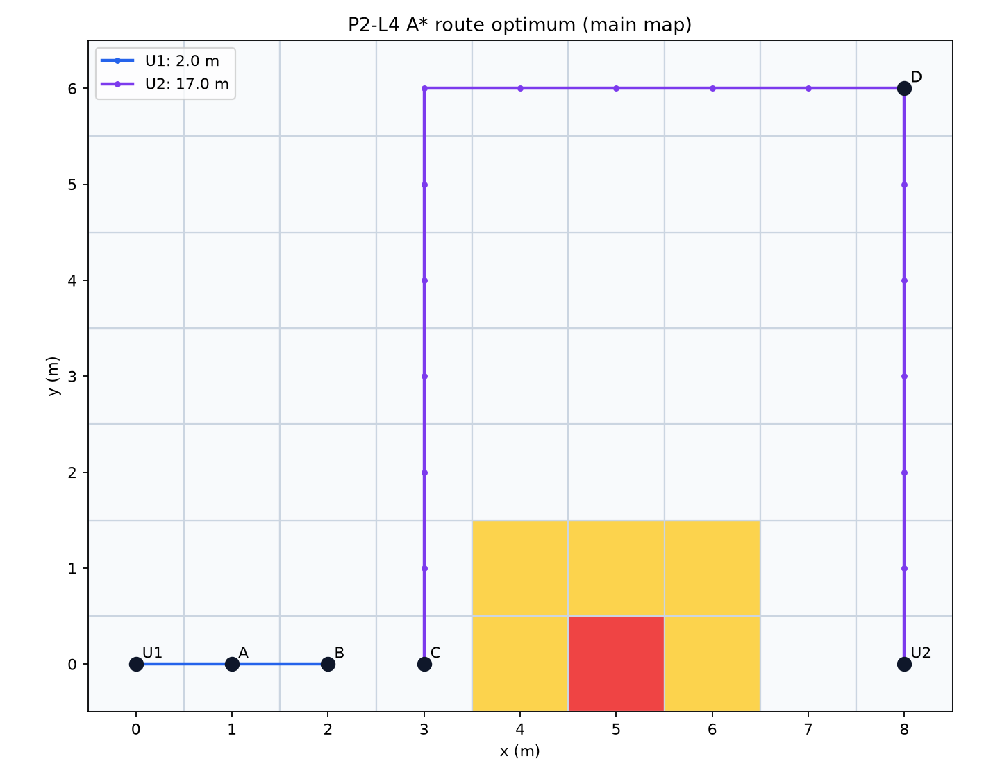

### 5.2 多艇协同：成功与预算受限失败一起看

两组共用地图、初始任务、分配和执行规则，受限组只将 U3 移动预算改为 12 NEU。观察任务颜色、艇的移动和停止状态，能看到“计划分配成功”之后仍可能执行失败。

| 场景 | 完成任务 | 团队完成时间／s | 全窗移动能耗／NEU |
|---|---:|---:|---:|
| 正常预算 | 20/20 | 48 | 380 |
| 仅 U3 预算受限 | 16/20 | null | 314 |

<table>
<tr><th>正常预算：20/20 完成</th><th>U3 预算受限：16/20 完成</th></tr>
<tr><td></td><td></td></tr>
</table>

失败时间保留 `null`，120 s 是观察截止；完成量不同，不能仅凭受限组能耗较低就判断它更节能。[最终指标与规则](results/p3_baseline/README.md)

### 5.3 动态接手：故障以后，剩余任务由谁完成

两组使用同一初始分配、洋流、任务到达、故障时刻和预算，只改变事件响应策略。**静态组保留原归属，动态组根据当前状态重新接手任务。** 以下两张原日志快照都取 t65，便于直接比较最终任务状态。

| 策略 | 完成任务 | 团队完成时间／s | 全窗移动能耗／NEU |
|---|---:|---:|---:|
| 固定归属 | 16/22 | null | 212.864764 |
| 动态响应 | 22/22 | 65 | 312.864764 |

<table>
<tr><th>固定归属：仍有任务未完成</th><th>动态接手：22/22 完成</th></tr>
<tr><td>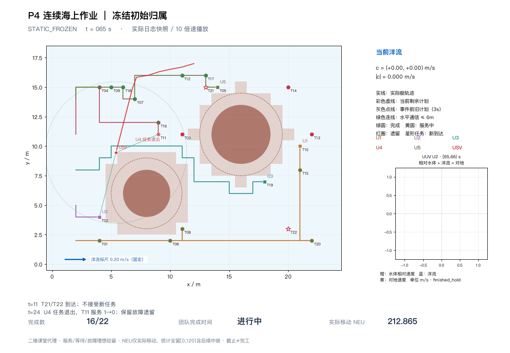</td><td>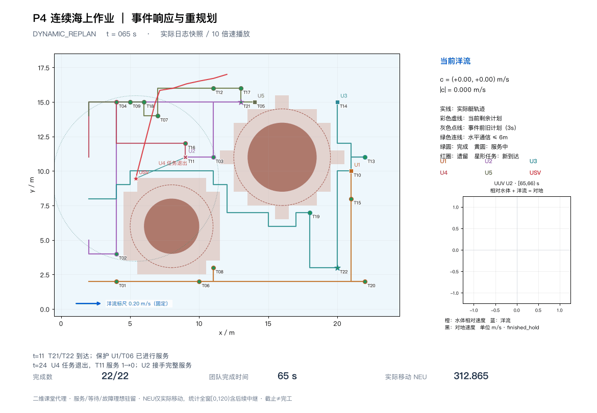</td></tr>
</table>

图取自原GIF的t65帧，观察新任务和U4故障后的任务归属、服务变化。[最终指标](results/p4_dynamic/README.md)

### 5.4 四／八邻接：路线改变怎样传到整个执行过程

X1 两组均完成 22/22：四邻接 **150.621588069 m／65 s**，八邻接 **120.973907199 m／54 s**。先看结果差异，再看实际路线在哪里变化。

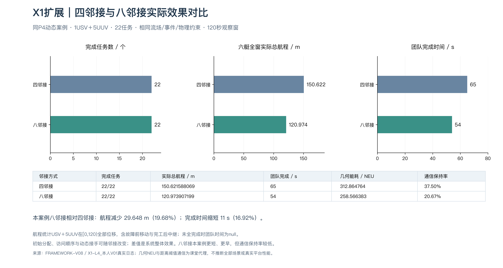

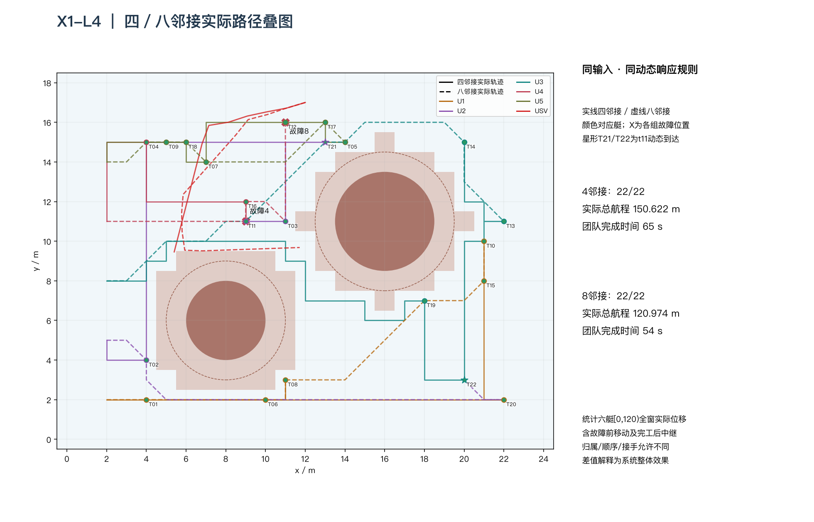

邻接变化也可能改变分配、顺序、动态接手和中继，所以这里比较的是系统整体效果。[X1最终指标](results/x1_adjacency/README.md)

### 5.5 六种路径方法：同时看指标和执行过程

六组使用共同动态案例，航程统计六艇在 `[0,120)` 的全部实际位移，包括故障前移动和任务完工后的中继。

| 方法 | 完成任务 | 六艇实际总航程／m | 团队完成时间／s |
|---|---:|---:|---:|
| A* | 22/22 | 122.598182196 | 54 |
| Dijkstra | 22/22 | 122.598182196 | 54 |
| D* Lite | 22/22 | 122.598182196 | 53 |
| 原始 D* | 22/22 | 122.481068550 | 56 |
| 扫描＋A* | 22/22 | 196.679538967 | 85 |
| PSO | 22/22 | 122.481068550 | 55 |

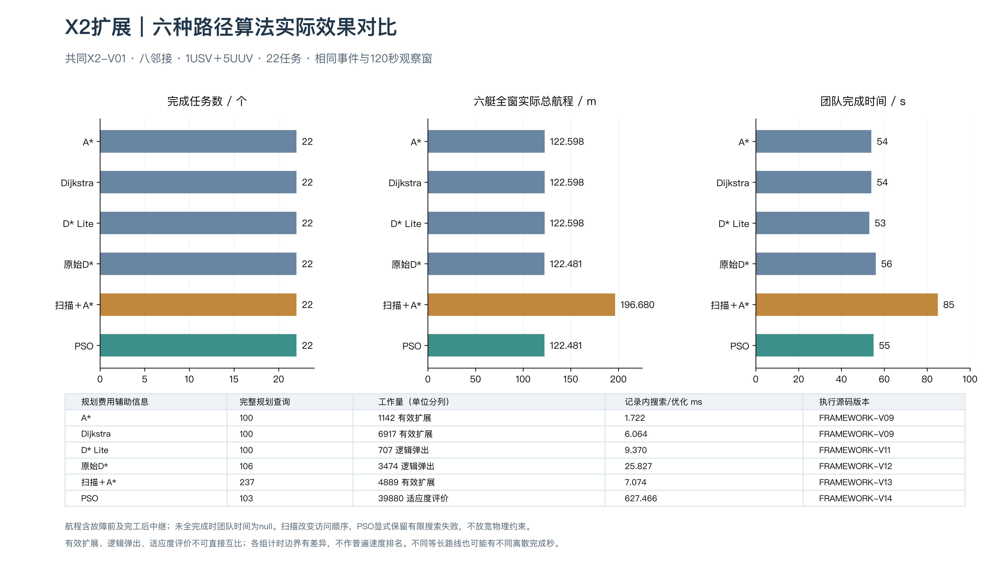

**六组独立运行同帧回放：**观察任务状态、故障接手、移动路线和完成进度。

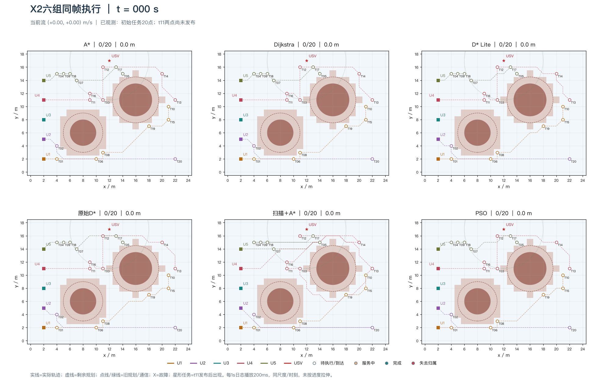

六组在本案例中都完成任务，航程和时间仍不同；这个排序不推广为普遍算法优劣。扫描改变访问顺序，PSO 是有限预算路径搜索，不同方法的搜索工作单位也需分别解释。[最终指标与比较口径](results/x2_algorithms/README.md)

### 5.6 单艇平台：任务下发之后，艇实际怎样运动

**MOOS任务闭环：**完成1/1，耗时19.08模拟秒，理想二维参考13.75秒；超时和非法目标未误报完成。下图从已保存NAV日志重绘，观察实际转向与航迹。

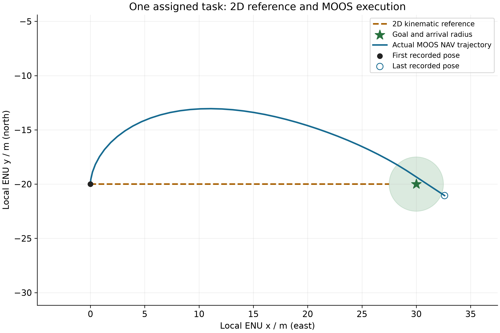

空心圈标出整段日志最后一条 NAV，并非专门标出的完成时刻；完成判定依据同任务反馈与当时进入到达范围的实际位置。

**VRX：空间路线与时间响应分开看。** 同一实测起点、前方 20 m 目标、标称速度和到达规则下，VRX 为 15.7 s，理想二维为 12.7 s。先看空间路线，再看进度、横偏和推力随时间的变化。

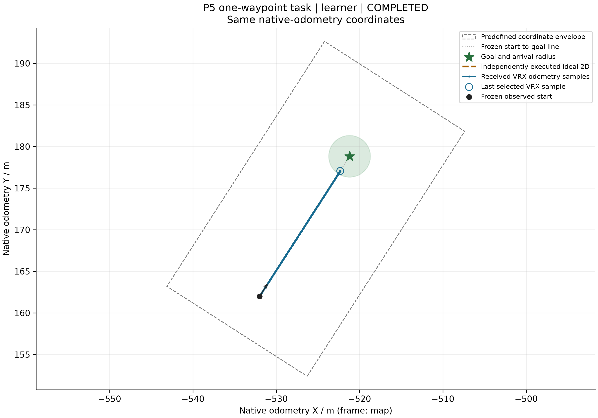

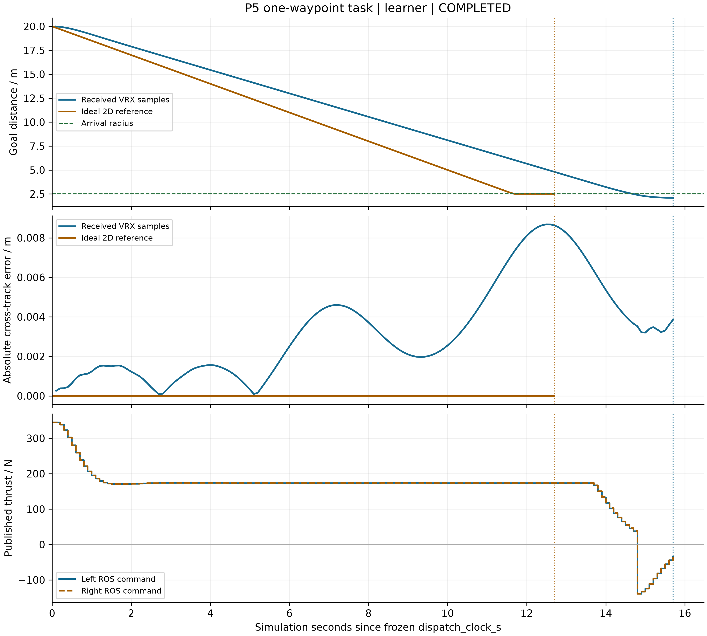

两条空间路线近乎重合，主要差异体现在时间响应；本次 VRX 最大横向偏差约 0.008682 m。该单次对照反映当前模型与控制设置下的整体差异，不单独证明某项水动力因素的贡献。

**第三人称实景：**悉尼水域中的完整WAM-V、设备平台与岸线，1600×900实际渲染。两个角度帮助理解载体和环境，任务效果结合上方航迹与时间读数判断。

<table>
<tr><th>侧面近景：艇体与设备平台</th><th>艇首斜侧方：双浮筒与岸边场景</th></tr>
<tr>
<td width="50%">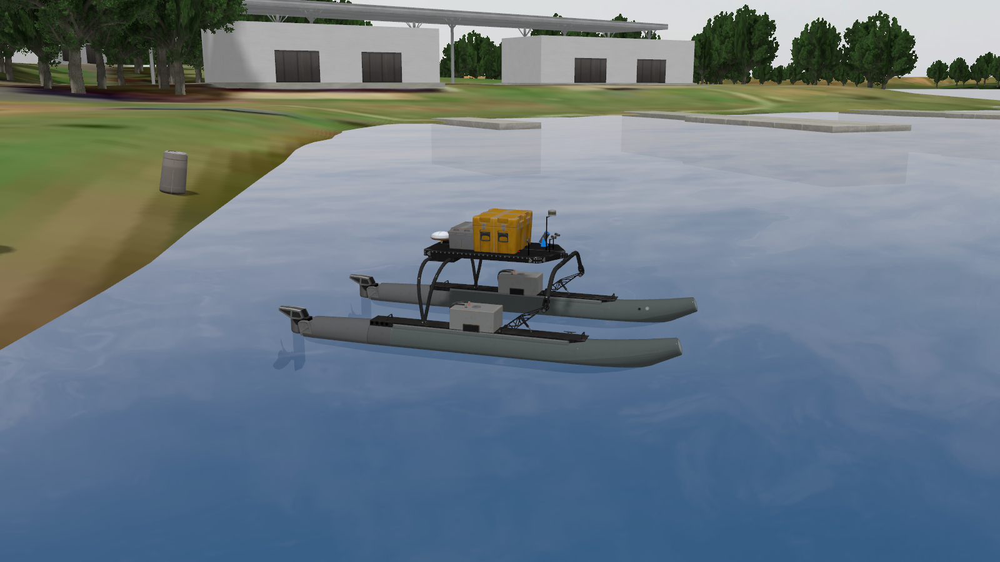</td>
<td width="50%">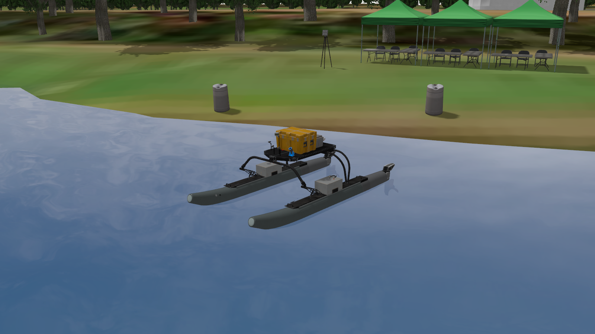</td>
</tr>
</table>

两图分别来自独立的展示取景，未发布推进指令；观察相机没有接入规划和控制。[另一构图及相机位姿、图像来源](results/p5_platforms/README.md#第三人称外部视角)。

**艇载图像通路：**原例实收1280×720 RGB8首帧，图像未参与规划和控制；该原例采样位移为6.093563 m。

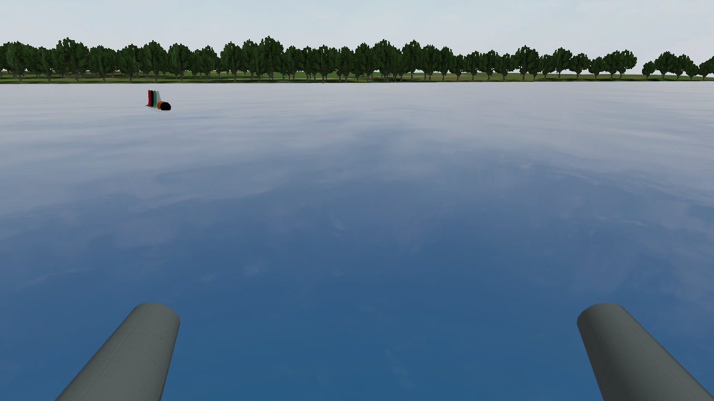

MOOS、VRX 原例和 VRX 配对分别运行，0 次坐标包络事件不代表连续避碰证明；项目尚未验证真实水声、物理电池功耗、水下六自由度、多艇平台联动或实艇性能。[平台成果与指标](results/p5_platforms/README.md)

## 6、运行指南

### 6.1 环境

| 用途 | 本项目已验证的环境／依赖 | 说明 |
|---|---|---|
| 二维主实验与绘图 | Python 3.13；NetworkX、NumPy、Matplotlib、Pillow、OR-Tools | 固定直接依赖见 [core.txt](requirements/core.txt)；macOS依赖锁见 [macos-lock.txt](requirements/macos-lock.txt) |
| Pyomo 初始分配与 X1 完整融合 | 独立 Python 环境；Pyomo、HiGHS | 见 [solver.txt](requirements/solver.txt)，使用 `.venv-solver/` |
| MOOS 新平台运行 | 外部已编译 MOOS-IvP | 不随本仓库提供二进制，按实际检出位置启动 |
| VRX 新平台运行 | Ubuntu 24.04、系统 Python 3.12、ROS 2 Jazzy、Gazebo Harmonic | VRX 与 Fuel 身份、环境准备见 [Linux 运行说明](docs/vrx_environment.md) |

二维主实验可在本机完成；新的MOOS／VRX执行使用各自的平台环境。

### 6.2 从获取代码到查看结果

流程为：**获取代码 → 安装环境 → 校验代码与输入 → 运行实验 → 查看摘要与绘图。**

在终端执行：

```bash
git clone https://github.com/xxz007/usv-uuv-cooperative-planning-reproduction.git
cd usv-uuv-cooperative-planning-reproduction
python3.13 -m venv .venv
.venv/bin/python -m pip install -r requirements/core.txt
.venv/bin/python -B tools/verify_release.py
.venv/bin/python -B -m usv_uuc_cooperation.main compare --case X2-L1 --run-id readme_core_01
.venv/bin/python -B -m usv_uuc_cooperation.main render --stage X2 --run "$PWD/results/x2_algorithms/runs/readme_core_01" --revision V01
```

- **运行摘要**：`results/x2_algorithms/runs/readme_core_01/摘要.md`。
- **本次图像**：`results/x2_algorithms/showcase/readme_core_01/V01/`。
- **关注读数**：两组均应为 **22/22 任务、122.598182196 m、54 s**。搜索计时随机器和运行变化，图像字体也可能不同。
- **重复尝试**：更换 `--run-id`；旧结果不覆盖。制图读取保存日志，不再启动模拟。

### 6.3 运行其他实验

主环境命令前缀均为 `.venv/bin/python -B -m usv_uuc_cooperation.main`。

| 实验 | 在命令前缀后添加的参数 |
|---|---|
| 地图三场景 | `run --stage P1 --run-id readme_p1_01` |
| 贪心／枚举分配 | `run --stage P2 --run-id readme_p2_01` |
| 协同成功／受限失败 | `run --stage P3 --case ALL --run-id readme_p3_01` |
| 四／八邻接路径 | `plan --case X1-L1 --run-id readme_paths_01` |
| 原路径执行 | `execute --case X1-L2 --run-id readme_execute_01` |
| 重新分配 | `assign --case X1-L3 --phase reassign --run-id readme_assign_01` |
| D* Lite | `compare --case X2-L2 --run-id readme_dstar_lite_01` |
| 原始 D* | `compare --case X2-Dstar --run-id readme_dstar_01` |
| 扫描＋A* | `compare --case X2-Scan --run-id readme_scan_01` |
| PSO | `compare --case X2-PSO --run-id readme_pso_01` |

P4／X1求解与融合另建求解环境：

```bash
python3.13 -m venv .venv-solver
.venv-solver/bin/python -m pip install -r requirements/solver.txt
.venv-solver/bin/python -B -m usv_uuc_cooperation.main solve --stage P4 --run-id readme_initial_01
.venv/bin/python -B -m usv_uuc_cooperation.main run --stage P4 --case ALL --run-id readme_dynamic_01 --initial-result "$PWD/results/p4_dynamic/runs/readme_initial_01/初始分配.json"
.venv/bin/python -B -m usv_uuc_cooperation.main integrate --case X1-L4 --run-id readme_x1_full_01
```

每次更换运行名；重新制图前先生成相应实验日志。仓库保留最终成果与指标，原始完整运行日志和过程记录保存在本地。`tools/verify_release.py`只检查当前发布文件及源码／输入身份。

### 6.4 平台运行

MOOS需先在仓库外编译MOOS-IvP，替换下方绝对路径后执行：

```bash
.venv/bin/python -B -m usv_uuc_cooperation.experiments.p5_moos --run-id moos_new_01 --moos-root /path/to/moos-ivp --role learner
```

VRX环境准备、固定源码和完整运行命令见[Linux／VRX运行指南](docs/vrx_environment.md)。第三方软件与大型模型由使用者另行安装，不随本仓库上传。
