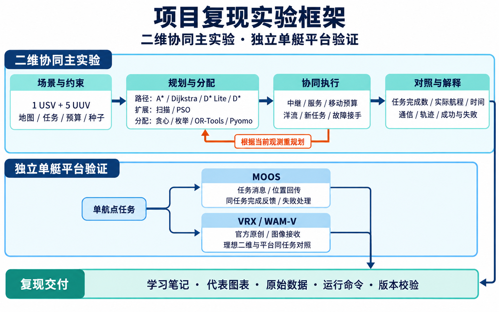
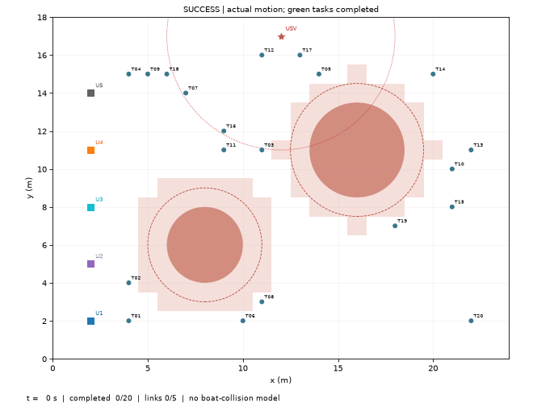

# 项目复现

我们让一艘水面艇和五艘水下航行器在二维仿真中分工完成任务，比较不同规划方法，并用 MOOS 和 VRX 验证单艇任务能否执行并回报完成。

## 1、流程框架



*流程图由 image-gen 生成，用于说明实验关系；下文的结果图和指标来自保存的实际模拟／平台运行。*

项目分成两条线推进：**二维主实验**研究路径、分配与动态执行；**平台支线**分别检查 MOOS 和 VRX 的单艇接口。两条线各自保存证据，目前没有将完整的 1 USV＋5 UUV 协同过程迁入平台。

## 2、项目结构

```text
usv-uuv-cooperative-planning-reproduction/
├── README.md                       # 项目总览与运行入口
├── usv_uuc_cooperation/             # 运行代码；UUC为历史包名
│   ├── configs/                    # 固定场景与实验参数
│   ├── env/                        # 地图、障碍、几何通信与流场
│   ├── planning/                   # 路径搜索与路径连接
│   ├── scheduling/                 # 任务分配、排序与求解接口
│   ├── control/                    # 服务、预算、洋流与动态执行
│   ├── experiments/                # 各类实验和平台入口
│   ├── metrics/                    # 指标与保存数据独立核查
│   └── visualization/              # 从运行日志生成图与动画
├── docs/
│   ├── learning/                   # 学习路线和六篇主题笔记
│   └── assets/                     # README流程图
├── data/
│   ├── inputs/                     # 六份必要的固定来源数据
│   └── provenance/                 # 版本、来源与文件校验
├── results/                        # 代表图、指标和必要原始数据
│   ├── p1_pathfinding/             # 地图与A*三场景
│   ├── p2_assignment/              # 分配与路线案例
│   ├── p3_baseline/                # 协同执行成功／受限失败
│   ├── p4_dynamic/                 # 静态归属／动态响应
│   ├── x1_adjacency/               # 四／八邻接融合比较
│   ├── x2_algorithms/              # 六种路径方法比较
│   ├── p5_platforms/               # MOOS／VRX单艇数据
│   └── p6_reproduction/            # 整合与目录迁移验证
├── tools/                          # 发布内容与保存数据检查
└── requirements/                   # 主环境与独立求解环境依赖
```

新运行写入对应案例的 `runs/<运行名>/`，图写入 `showcase/`，核查输出写入 `checks/`；这些新生成目录默认不提交。较长动画、旧发布报告和完整本地课堂档案的范围见[来源与归档说明](docs/sources.md)。

## 3、学习路线

1. **先理解地图和安全路径。** 把连续场景放到网格中，学习安全缓冲、A*、四／八邻接，以及路径长度与执行时间的区别。[路径规划笔记](docs/learning/01_path_planning.md)
2. **再理解任务如何分给不同艇。** 从贪心与枚举的小例子出发，接入 OR-Tools／Pyomo，区分分配成本、完整航程和团队完成时间。[任务分配笔记](docs/learning/02_task_allocation.md)
3. **把计划接成可执行过程。** 加入任务顺序、移动预算、到达、服务和 USV 中继，观察成功与受限失败。[协同执行笔记](docs/learning/03_cooperative_execution.md)
4. **处理执行中的变化。** 加入洋流、新任务、临时禁行与故障，理解当前状态、服务保护、重新分配和剩余任务接手。[动态重规划笔记](docs/learning/04_dynamic_replanning.md)
5. **在共同案例中比较方法。** 对照六种路径方案，统一任务、观测事件和统计口径，保留失败与方法边界。[算法比较笔记](docs/learning/05_algorithm_comparison.md)
6. **检查任务如何进入仿真平台。** 分别核对 MOOS 的任务反馈，以及 VRX 的位姿、推力、相机和二维参考。[平台验证笔记](docs/learning/06_moos_vrx.md)
7. **整理为别人可以重跑的记录。** 固定输入、依赖和命令，从保存数据复核结果，并保留模型边界。[学习路线总览](docs/learning/README.md) · [复现与迁移验证](results/p6_reproduction/README.md)

## 4、实验拆解

| 实验 | 要回答的问题 | 实施与对照 | 主要产出 |
|---|---|---|---|
| 地图与路径（P1） | 有障碍时能否找到合法路径，何时应返回不可达？ | 同地图检查基准、增障和不可达三场景 | [三场景路径图](results/p1_pathfinding/README.md) |
| 分配与排序（P2） | 最近的分配是否也让整条任务路线最好？ | 贪心、枚举、CP-SAT；分列固定起点成本与完整路线 | [小案例与反例](results/p2_assignment/README.md) |
| 协同基线（P3） | 分配之后，任务能否在服务和预算规则下完成？ | 同一 1＋5＋20 场景，正常预算对照仅 U3 预算受限 | [成功／失败数据及动画](results/p3_baseline/README.md) |
| 洋流与动态事件（P4） | 新任务或故障出现后，固定归属与动态接手有何差别？ | 同初始分配、流场、事件及预算，只改变事件响应策略 | [静态／动态指标与同帧快照](results/p4_dynamic/README.md) |
| 规划到系统效果（X1／X2） | 邻接和路径方法的变化会怎样影响完整执行？ | 四／八邻接融合；六种路径方法在共同动态案例中执行 | [X1](results/x1_adjacency/README.md) · [X2](results/x2_algorithms/README.md) |
| 平台接口（P5） | 下发目标后，能否读回实际位置并正确判断完成或失败？ | 单艇 MOOS 闭环；单 WAM-V 原例与独立理想二维同任务对照 | [平台数据、图像与核查入口](results/p5_platforms/README.md) |
| 可重复交付（P6） | 换一个代码副本后，能否得到一致的核心结果？ | 固定提交、输入和依赖；核心复跑、保存数据重查与恢复核对 | [整合验证记录](results/p6_reproduction/README.md) |

二维动态实验使用 20 个初始任务，t11 新增 2 个任务；X2 还观察 t6 临时禁行、t18 撤销，以及 t24 的 U4 故障。规划使用当前观测与当前执行状态。通信为距离阈值评价，NEU 为几何移动代理；目前的动态分配是集中式事件触发机制。[完整范围与研究缺项](docs/scope.md)

## 5、复现结果

### 5.1 成功、失败与动态接手

| 场景／策略 | 完成任务 | 团队完成时间／s | 全窗移动能耗／NEU |
|---|---:|---:|---:|
| P3：正常预算 | 20/20 | 48 | 380 |
| P3：仅 U3 预算受限 | 16/20 | null | 314 |
| P4：固定归属 | 16/22 | null | 212.864764 |
| P4：动态响应 | 22/22 | 65 | 312.864764 |

P3 表明“分配出任务”之后仍可能因执行预算不足而失败；P4 则展示动态接手在这个案例中补全了任务。失败时间保留 `null`，不能把 120 s 截止当成完成时间；完成量不同，也不能仅凭失败组能耗较低就判断其更节能。



[P3 受限失败动画及原始数据](results/p3_baseline/README.md) · [P4 静态／动态同一 t65 快照](results/p4_dynamic/README.md)

### 5.2 路径方法与完整系统效果

X1 两组都完成 22/22 个任务：四邻接为 **150.621588069 m／65 s**，八邻接为 **120.973907199 m／54 s**。分配、顺序和动态接手也可能随邻接改变，所以这里比较的是系统整体效果。

X2 的六组结果如下，航程统计六艇在 `[0,120)` 的全部实际位移，包括故障前移动和任务完工后的中继。

| 方法 | 完成任务 | 六艇实际总航程／m | 团队完成时间／s |
|---|---:|---:|---:|
| A* | 22/22 | 122.598182196 | 54 |
| Dijkstra | 22/22 | 122.598182196 | 54 |
| D* Lite | 22/22 | 122.598182196 | 53 |
| 原始 D* | 22/22 | 122.481068550 | 56 |
| 扫描＋A* | 22/22 | 196.679538967 | 85 |
| PSO | 22/22 | 122.481068550 | 55 |


六组在本案例中都完成了任务，航程和时间仍有差异；这个排序不直接推广为其他场景的算法优劣。扫描改变访问顺序，PSO 是有限预算路径搜索；不同方法的搜索工作单位也需要分别解释。[原指标、精选日志与边界](results/x2_algorithms/README.md)

### 5.3 MOOS／VRX 单艇平台验证

| 实验 | 已保存结果 | 能回答的问题 |
|---|---|---|
| MOOS 任务闭环 | 1/1 完成，19.08 模拟秒；TIMEOUT／非法目标未误报完成 | 同任务目标、实际 NAV 与完成反馈能否对应起来？ |
| VRX 官方原例 | 原生位姿重算位移 6.093563 m，实收 1280×720 RGB8 首帧 | 艇体、推力、位姿和图像通路能否在场景中工作？ |
| VRX 与理想二维同任务 | VRX 15.7 s，对照 12.7 s；VRX 最大横偏约 0.008682 m | 在相同起点、目标与到达规则下，两种模型的整体执行响应有何差别？ |

MOOS、VRX 原例和 VRX 配对分别运行。上表的平台时间不作跨平台排名；0 次坐标包络事件也不代表已证明连续避碰安全。[时间／进度／误差图](results/p5_platforms/figures/VRX_progress_error.png) · [平台数据与复核](results/p5_platforms/README.md)

截至 2026-10-31，第三人称外部视角仍等待云端资源恢复后重新取景；现有艇载首帧保留为传感器证据。项目尚未验证真实水声、物理电池功耗、水下六自由度、多艇平台联动或实艇性能。

## 6、运行指南

### 6.1 环境

| 用途 | 本项目已验证的环境／依赖 | 说明 |
|---|---|---|
| 二维主实验与绘图 | Python 3.13；NetworkX、NumPy、Matplotlib、Pillow、OR-Tools | 固定直接依赖见 [core.txt](requirements/core.txt)；P6 的 macOS 完整解析记录见 [macos-lock.txt](requirements/macos-lock.txt) |
| Pyomo 初始分配与 X1 完整融合 | 独立 Python 环境；Pyomo、HiGHS | 见 [solver.txt](requirements/solver.txt)，使用 `.venv-solver/` |
| MOOS 新平台运行 | 外部已编译 MOOS-IvP | 不随本仓库提供二进制，按实际检出位置启动 |
| VRX 新平台运行 | Ubuntu 24.04、系统 Python 3.12、ROS 2 Jazzy、Gazebo Harmonic | VRX 与 Fuel 身份、环境准备见 [Linux 运行说明](docs/vrx_environment.md) |

二维主实验和保存结果核查可在本机完成；新的 MOOS／VRX 执行使用各自的平台环境。

### 6.2 从获取代码到查看结果

流程为：**获取代码 → 安装主环境 → 校验输入与保存结果 → 运行核心对比 → 打开摘要 → 从本次日志绘图。**

在终端执行（私有仓库需要已有访问权限）：

```bash
git clone --branch preview/learning-layout-v1 https://github.com/xxz007/usv-uuv-cooperative-planning-reproduction.git
cd usv-uuv-cooperative-planning-reproduction
python3.13 -m venv .venv
.venv/bin/python -m pip install -r requirements/core.txt
.venv/bin/python -B tools/verify_release.py
.venv/bin/python -B tools/verify_saved_results.py
.venv/bin/python -B -m usv_uuc_cooperation.main compare --case X2-L1 --run-id readme_core_01
.venv/bin/python -B -m usv_uuc_cooperation.main render --stage X2 --run "$PWD/results/x2_algorithms/runs/readme_core_01" --revision V01
```

- **运行摘要**：`results/x2_algorithms/runs/readme_core_01/摘要.md`。
- **本次图像**：`results/x2_algorithms/showcase/readme_core_01/V01/`。
- **关注读数**：两组均应为 **22/22 任务、122.598182196 m、54 s**。搜索计时随机器和运行变化，图像字体也可能不同。
- **重复尝试**：更换 `--run-id`；旧结果不覆盖。制图读取保存日志，不再启动模拟。

### 6.3 运行其他实验

主环境命令前缀均为 `.venv/bin/python -B -m usv_uuc_cooperation.main`。

| 实验 | 在命令前缀后添加的参数 |
|---|---|
| 地图三场景 | `run --stage P1 --run-id readme_p1_01` |
| 贪心／枚举分配 | `run --stage P2 --run-id readme_p2_01` |
| 协同成功／受限失败 | `run --stage P3 --case ALL --run-id readme_p3_01` |
| 四／八邻接路径 | `plan --case X1-L1 --run-id readme_paths_01` |
| D* Lite | `compare --case X2-L2 --run-id readme_dstar_lite_01` |
| 原始 D* | `compare --case X2-Dstar --run-id readme_dstar_01` |
| 扫描＋A* | `compare --case X2-Scan --run-id readme_scan_01` |
| PSO | `compare --case X2-PSO --run-id readme_pso_01` |

若运行 P4／X1 的求解与融合实验，另建求解环境：

```bash
python3.13 -m venv .venv-solver
.venv-solver/bin/python -m pip install -r requirements/solver.txt
.venv-solver/bin/python -B -m usv_uuc_cooperation.main solve --stage P4 --run-id readme_initial_01
.venv/bin/python -B -m usv_uuc_cooperation.main run --stage P4 --case ALL --run-id readme_dynamic_01 --initial-result "$PWD/results/p4_dynamic/runs/readme_initial_01/初始分配.json"
.venv/bin/python -B -m usv_uuc_cooperation.main integrate --case X1-L4 --run-id readme_x1_full_01
```

完整输出路径、单算法制图及保存数据范围见[复现说明](docs/reproduction.md)；MOOS／VRX 的离线复核和新平台启动见[平台说明](docs/platforms.md)。当前为私有结构预览分支，源码 FRAMEWORK-V21；原课程与基线提交保持，更多来源见[资料与归档](docs/sources.md)。
