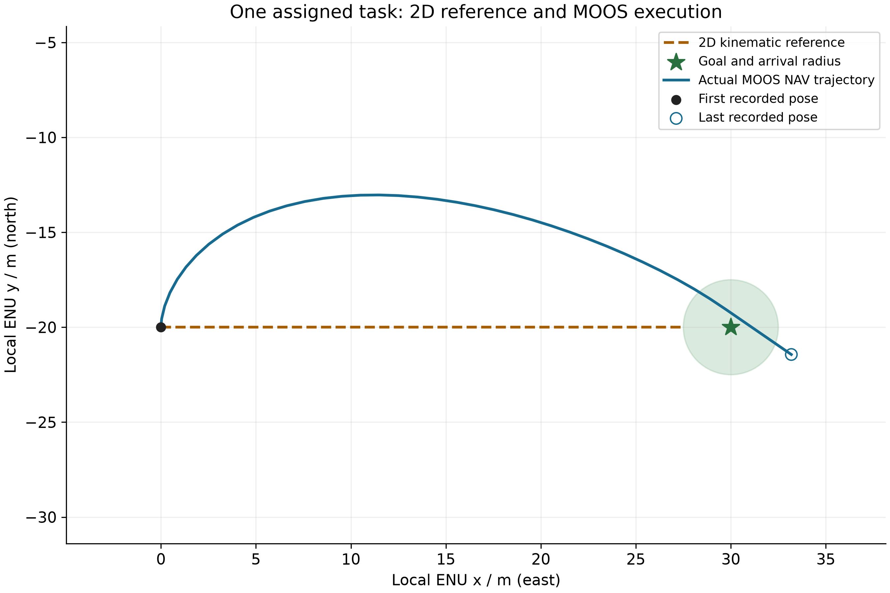

# P5 平台工程证据与剩余范围

**MOOS 教师工程核查 PASS；P5 整阶段仍 IN_PROGRESS。** 本人运行／解释尚待完成；VRX 拟租用 AutoDL Linux 实例后经 SSH 核验，具体环境以实际实例和兼容性检查为准。P6 尚未开始。

实际平台执行版本为 **FRAMEWORK-V17**，保存日志读取／分析版本为 **FRAMEWORK-V18**。读取边界修复只清理 alog 值两端空白，没有修改控制或物理输入。保存复核新增平台、模拟、求解器运行均为 0；原运行 93 份文件的 SHA 前后保持记录已保留。

| 核心读数 | 结果 |
|---|---:|
| 完成任务 | 1/1 |
| MOOS 派发至完成 / 模拟秒 | 19.45998 |
| 派发至完成窗口最大横向偏差 / m | 6.96641 |

| 同任务对照 | 完成时间 / 模拟秒 | 最大横向偏差 / m |
|---|---:|---:|
| 二维运动学参考 | 13.75000 | 0.00000 |
| 实际 MOOS NAV | 19.45998 | 6.96641 |

共同起点 (0,-20) m、目标 (30,-20) m、目标速度 2 m/s、到达容差 2.5 m、初始航向元数据 0°。MOOS 包含转向和速度响应，二维参考不包含这些动力学，因此不宣称两者物理模型相同。当前未测推进功率或真实电量。

成功同时要求同一任务 ID 的派发、Helm 行为完成反馈，以及容差内的实际 NAV 位置。短等待窗口得到 TIMEOUT，无效远目标在发布前被 REJECTED，均未误报完成。等待窗口是 uQueryDB 从自身启动起计算的 MOOS 时间，不是严格的派发至完成截止。包络违规只监测记录 NAV 是否超出固定 x/y 范围，不代表障碍或艇间碰撞安全证明。

[工程复核 JSON](../输出文件/阶段结果/P5/P5-V01/checks/P5_教师V02_保存日志复核_V01/result.json) · [配对指标](../输出文件/阶段结果/P5/P5-V01/checks/P5_教师V02_保存日志复核_V01/paired_metrics.json) · [原运行 SHA 记录](../输出文件/阶段结果/P5/P5-V01/checks/P5_教师V02_保存日志复核_V01/source_SHA256.json) · [MOOS 成功 NAV CSV](../输出文件/阶段结果/P5/P5-V01/checks/P5_教师V02_保存日志复核_V01/success/trajectory.csv) · [二维参考 CSV](../输出文件/阶段结果/P5/P5-V01/checks/P5_教师V02_保存日志复核_V01/reference_2d.csv)

仓库按字节保留本次必要配置、任务反馈、NAV CSV 和三组实际原始 alog，省略冗余标准输出与查询临时文件。原始证据中的本机绝对路径作为来源保留；可复现入口从当前仓库根定位。原 93 文件全部身份保持是保存报告中的历史核查结论，本仓库仅发布清单列出的证据子集。

## 从发布的原始日志重新核查

以下只读取已保存数据，不启动平台。分析使用新名称，输出到新的 checks 目录；随后渲染该新分析目录，以免覆盖已保存展示。

```bash
.venv/bin/python -B 课时资料/P5/源码/复核P5保存日志_V01.py --source-run "$PWD/输出文件/阶段结果/P5/P5-V01/checks/P5_教师V02_保存日志复核_V01" --analysis-id replay_p5_saved_check_01
.venv/bin/python -B -m usv_uuc_cooperation.visualization.p5_moos --run 输出文件/阶段结果/P5/P5-V01/checks/replay_p5_saved_check_01
```

这套已执行的二维／MOOS对照是当前工程证据；原 P5 要求的 VRX/WAM-V 原例与二维／VRX配对仍待实际运行，不能用本结果替代。

## 已保存的真实轨迹展示



[MOOS 原例实际航迹](../输出文件/阶段结果/P5/P5-V01/showcase/P5_教师V02_保存日志复核_V01/MOOS_original_example.png) · [绘图来源 SHA](../输出文件/阶段结果/P5/P5-V01/showcase/P5_教师V02_保存日志复核_V01/来源.json) · [视觉核查](../输出文件/阶段结果/P5/P5-V01/showcase/P5_教师V02_保存日志复核_V01/视觉核查_V01.json) · [原展示摘要](../输出文件/阶段结果/P5/P5-V01/showcase/P5_教师V02_保存日志复核_V01/摘要.md)

轨迹图保留完成后的减速／漂移关停尾段，空心圆表示最后记录点。完成判据采用实际完成事件前最近的 NAV 位置，读数只统计派发至完成窗口；图中最后位置不代表完成判据发生的位置。
