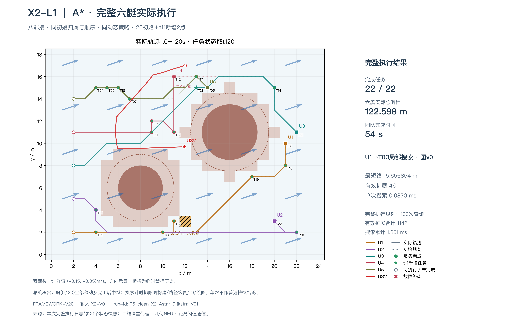

# P6复现与整合交付

P6按工程交付完成，沿用P0～P5/X1/X2的已通过证据，没有新课堂补考或新研究实验。源码保持FRAMEWORK-V20／106项＋4输入。研究问题卡是建议，不表示作者已正式选题。

## 实际干净副本复跑

从真实远端GitHub新克隆并固定到`897252495be37690a93439921c1aa6bc12cb2065`，在现有macOS主机以Python3.13.15新建独立venv、关闭系统／用户site包并重新安装依赖。项目与19项解析依赖的导入位置已检查，不是全新操作系统或跨系统验证。

| 算法 | 任务完成 | 六艇全窗航程m | 团队完成时间s |
|---|---:|---:|---:|
| A* | 22/22 | 122.59818219586397 | 54 |
| 独立Dijkstra | 22/22 | 122.59818219586397 | 54 |

相同X2-V01／random_seed20261008／八邻接，t6禁行、t11两任务到达、t18撤销禁行、t24 U4故障；每组121快照、720步。仅排除framework、search_ns、build_ns、重规划wall_time_s后，所有结果字段和完整搜索记录与原验收基线精确相等。初版比较器补齐墙钟计时排除项后只重查产物，没有重跑模拟。两张新图已视觉检查，几何和三读数一致；运行名、计时和字体可能使图片字节不同。

[独立核查](p6_reproduction_check.json) · [运行摘要](../输出文件/阶段结果/X2/X2-V01/runs/P6_clean_X2_Astar_Dijkstra_V01/摘要.md) · [环境与命令](../输出文件/阶段结果/P6/P6-V01/reproduction/environment.json) · [完整依赖锁定](../requirements-reproduced-macos.txt)



[Dijkstra新图](../输出文件/阶段结果/X2/X2-V01/showcase/P6_clean_X2_Astar_Dijkstra_V01/V01/Dijkstra_效果图.png)

本次工程主命令1次、完整组2个，本人新增运行0。原始统一核查中的learner_acceptance／visual_check是历史入口模板；本页和P6报告登记工程及视觉证据，不修改原始日志冒充本人运行。Pyomo独立求解环境、MOOS和VRX没有在P6重装重跑，沿用原验证。

## 其他人重跑

```bash
python3.13 -m venv .venv
.venv/bin/python -m pip install -r requirements-core.txt
.venv/bin/python -B tools/verify_release.py
.venv/bin/python -B tools/verify_p6_saved.py
.venv/bin/python -B -m usv_uuc_cooperation.main compare --case X2-L1 --run-id replay_p6_core_01
.venv/bin/python -B -m usv_uuc_cooperation.main render --stage X2 --run "$PWD/输出文件/阶段结果/X2/X2-V01/runs/replay_p6_core_01" --revision V01
```

摘要在`输出文件/阶段结果/X2/X2-V01/runs/replay_p6_core_01/摘要.md`，图在对应showcase/replay_p6_core_01/V01；运行名需唯一。完整macOS锁文件可用于相同平台的进一步核对，不保证不同系统wheel和字体一致。[其他入口与外部平台依赖](reproduction.md)

## 成功、失败和恢复范围

P3的SUCCESS和RESTRICTED原始JSON／CSV／SHA及已有GIF一并保存。成功20/20、48s、380NEU；受限16/20、完成时间null、314NEU，唯一受限改动是U3移动预算12NEU。失败能耗更低不构成完成同任务更节能。本次只复制核对，没有重跑P3。

[P3原始成功／受限记录](../输出文件/阶段结果/P3/P3-V01/runs/框架迁移核查_教师V01/摘要.md) · [成功GIF](../输出文件/阶段结果/P3/P3-V01/showcase/SUCCESS.gif) · [受限GIF](../输出文件/阶段结果/P3/P3-V01/showcase/RESTRICTED.gif)

本地版本恢复包包含打包时仓库快照、P6工具／配置和检查记录，完成CRC、逐SHA、独立解包及保存数据重查；不含venv、外部平台／模型、SSH信息或导师原文，不作为完整私人课堂资料副本。恢复结果另有外置报告，避免报告与其自身包哈希循环引用。仓库本身以RELEASE_CONTENTS.json核对内容。

[导师要求完成评估](project_assessment.md) · [一页候选研究问题卡](research_question.md)。课程主线和交付完成不等于导师六个科研方向全部实现；二维通信／NEU、单艇平台和实艇验证的边界保持。


最终本地包V02：390文件、62440545字节，SHA256 `29521cb1884c323ca70db2caa73b9c28f842cf7fef1edef45a848724e4bcc77a`。[独立恢复报告](p6_restore_report_v02.json)。V01保留为发布前检查点，已由V02取代为最终恢复入口。
