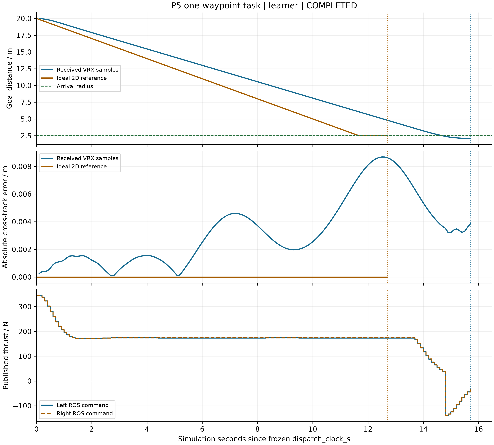

# 已保存结果与适用范围

以下读数来自已保存的原始运行，发布整理没有重跑这些完整案例。

## X1：四／八邻接完整动态案例

| 邻接 | 完成任务 | 六艇全窗实际航程/m | 团队完成时间/s |
|---|---:|---:|---:|
| 四邻接 | 22/22 | 150.621588069 | 65 |
| 八邻接 | 22/22 | 120.973907199 | 54 |

[指标原文件](../输出文件/阶段结果/X1/X1-V01/showcase/X1_完整扩展_数据对比_V01/V02/对比指标.json)

地图、洋流、任务到达、故障与动态策略相同；邻接改变后分配和顺序也可能变化，因此这里的差值属于整体系统效果。

## X2：六组同输入完整执行

| 方法 | 完成任务 | 六艇全窗实际航程/m | 团队完成时间/s |
|---|---:|---:|---:|
| A* | 22/22 | 122.598182196 | 54 |
| Dijkstra | 22/22 | 122.598182196 | 54 |
| D* Lite | 22/22 | 122.598182196 | 53 |
| 原始D* | 22/22 | 122.481068550 | 56 |
| 扫描＋A* | 22/22 | 196.679538967 | 85 |
| PSO | 22/22 | 122.481068550 | 55 |

[指标原文件](../输出文件/阶段结果/X2/X2-V01/showcase/X2_完整扩展_六组对比_V01/V02/对比指标.json) · [同帧 GIF](../输出文件/阶段结果/X2/X2-V01/showcase/X2_完整扩展_六组对比_V01/任务执行_同帧对比.gif)

共同八邻接、1 USV＋5 UUV、20 个初始任务＋t11 新增 2 个任务、t6 临时禁行／t18 撤销、t24 U4 故障、120 s 观察窗。航程统计六艇 [0,120) 全部实际位移，含故障前移动及完工后中继。团队完成时间取最后一个任务的完成时刻，未完成时为 null。

D* Lite 在这个案例的任务完成时间最短，不能推广为所有场景的普遍排名。不同算法的搜索计时边界和工作单位不同，不直接用这些费用做普遍速度排名。PSO 五个固定局部种子与最短路差 0 m，不证明所有查询或场景最优；未选中分配候选 query63 有 1.757359313 m 差距，不是实际多走里程。

## P3／P4 的解释性对照

P3 成功组完成 20/20 个任务、48 s；移动预算受限组只完成 16/20，完成时间为 null。P4 静态归属组完成 16/22，动态响应组完成 22/22、65 s。完成任务不同，不能仅凭失败组移动能耗较低声称完成同样工作更节能。

## P5：本人平台执行

P5 完整原范围、本人运行／解释及三项综合验收均 PASS；工程 VERIFIED、展示 RENDERED_VERIFIED。本人 MOOS 一次主命令完成 1/1，派发至完成 19.08 模拟秒；超时与非法目标均未误报。VRX 一次 all 命令包含独立原例和对照子运行。

| 本人保存的 VRX 同任务结果 | 完成时间／模拟秒 | 最大横向偏差／m | 预定义包络违规事件 |
|---|---:|---:|---:|
| 完整 WAM-V 动力学 | 15.7 | 0.008682373 | 0 |
| 独立理想二维运动学 | 12.7 | 约 0（5.46×10⁻¹³） | 0 |

共同实测起点／朝向、前方 20 m、标称速度 1.5 m/s、半径 2.5 m、连续有效采样保持 1 s、模拟预算 90 s。任务指标截止完成时刻，排除关停尾段，未完成时间为 null。二维模型没有 WAM-V 转向／推力／波浪／阻尼动力学，不把数值差异解释为算法普遍排名。

原例仍为官方默认船体：左右各 100 N、约 8 模拟秒内实际水平位移 6.093563 m，收到 1280×720 rgb8 原始帧。其位姿来自原生 Pose.name／id，而非用空 TF 字段猜测模型；对照完整船体只添加真值 Odometry 插件，保留原质量／惯量、动力学和 7 个传感器。

[P5 验收、原始数据与独立核查](p5_platform.md) · [验收 JSON](p5_acceptance.json) · [同坐标轨迹](../输出文件/阶段结果/P5/P5-V01/showcase/P5_本人VRX_V01/2D_VRX_same_task.png) · [原例相机帧](../输出文件/阶段结果/P5/P5-V01/showcase/P5_本人VRX_V01/original_first_camera_frame.png)

## 结果边界

MOOS、VRX、原例和配对是各自真实执行的独立平台运行，不拼接成统一仿真航迹。只监测原生采样坐标是否越出冻结包络，0 次违规不等于障碍／艇间碰撞安全。推力发布不是仿真端确认，也未测真实推进功率或电池。以上二维与平台仿真均不构成实艇或水声验证。P6 尚未开始；仓库保持 PRIVATE，公开另由作者明确决定。
