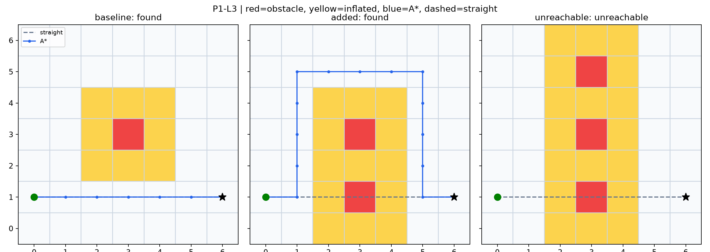

# P1｜地图与A*

基准6m、增加障碍14m、不可达返回null；地图与安全缓冲假设沿用原验收。

[相关学习笔记](../../docs/learning/01_path_planning.md) · [复现命令](../../README.md#6运行指南) · [结果口径](../../README.md#5复现结果) · [完整旧版归档](../../docs/sources.md)
