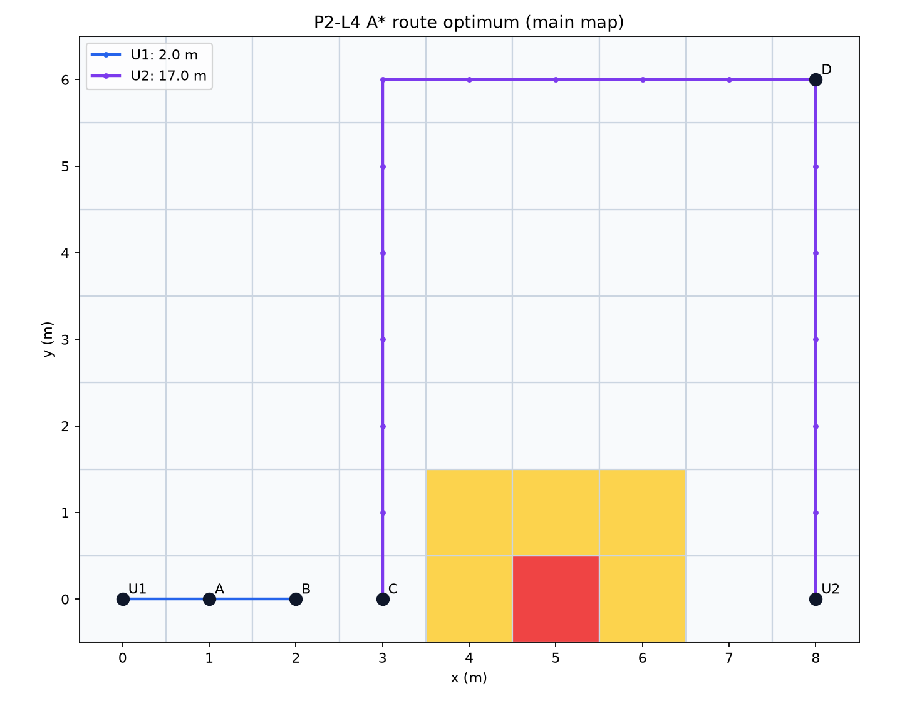

# P2｜分配与完整路线

固定起点分配基线14m，贪心反例约17.246211m对枚举15m；完整多任务路线与该分配目标分列。

[相关学习笔记](../../docs/learning/02_task_allocation.md) · [复现命令](../../README.md#6运行指南) · [结果口径](../../README.md#5复现结果) · [完整旧版归档](../../docs/sources.md)
