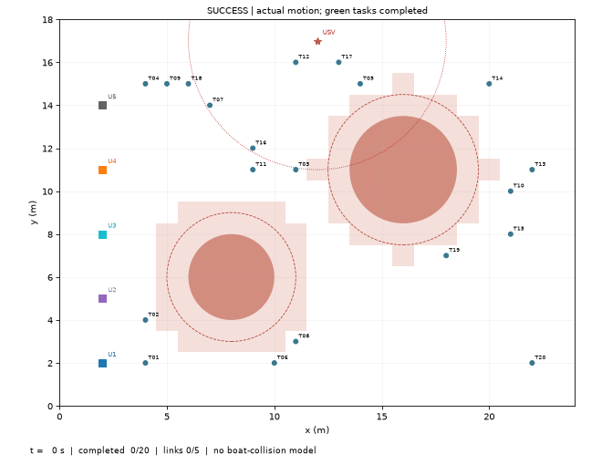

# 协同执行：正常与预算受限

同一1 USV＋5 UUV＋20任务；正常组20/20、48 s、380 NEU，受限组仅将U3预算改为12 NEU，结果16/20、完成时间null、314 NEU。较低失败能耗不代表完成同任务更节能。

[最终指标](metrics.json)

[项目结果总览](../../README.md#5复现结果) · [运行指南](../../README.md#6运行指南)
