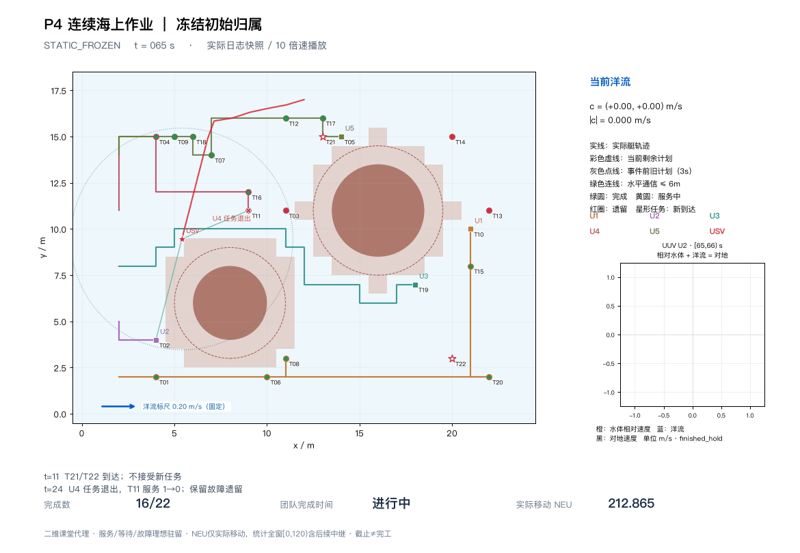
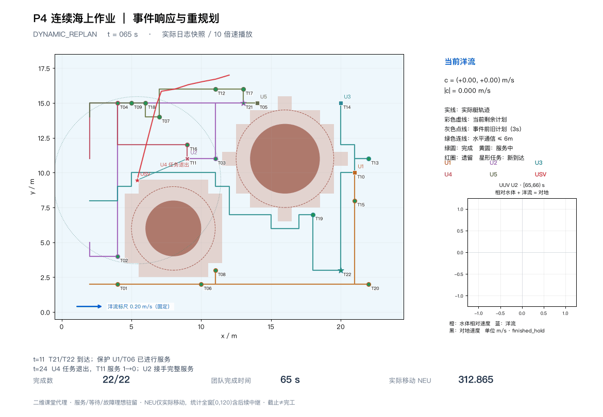

# P4｜静态归属与动态接手

同初始分配／洋流／事件／预算，静态16/22、时间null；动态22/22、65s。以下两图取原GIF相同t65帧，没有重跑或改画轨迹。

[原始指标](metrics.json)

[相关学习笔记](../../docs/learning/04_dynamic_replanning.md) · [复现命令](../../README.md#6运行指南) · [结果口径](../../README.md#5复现结果) · [完整旧版归档](../../docs/sources.md)
