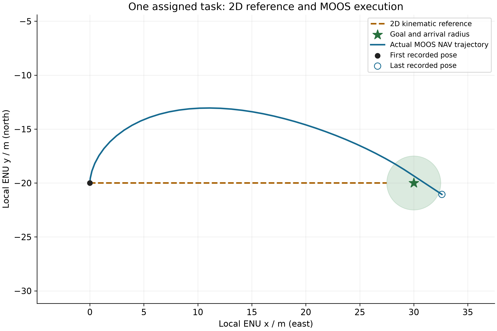
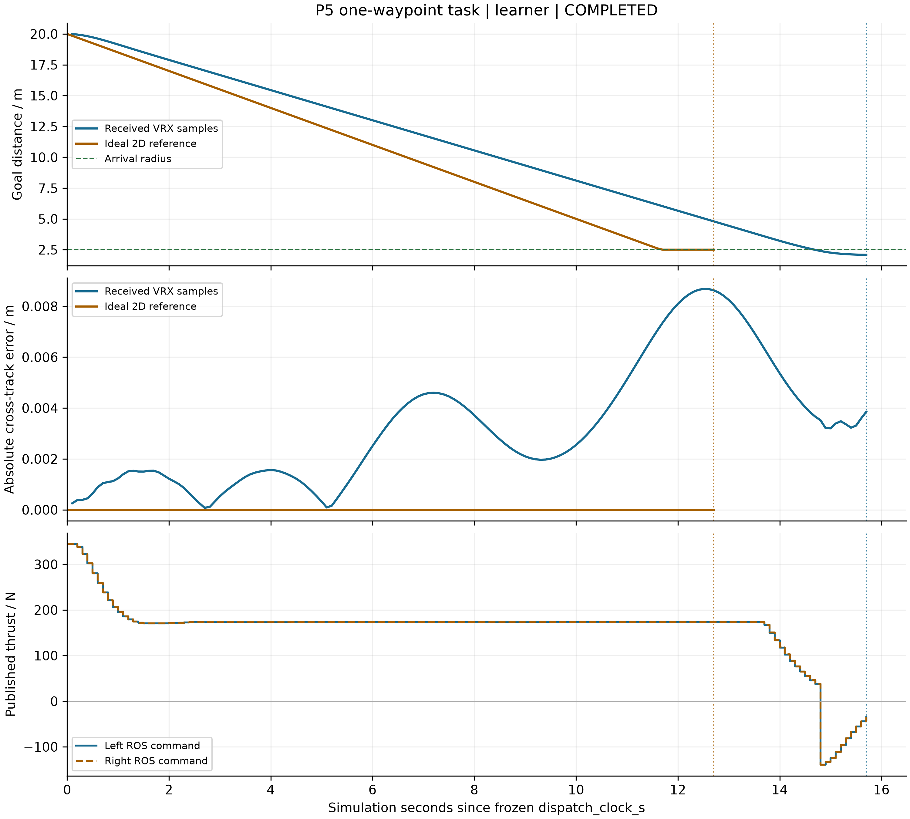
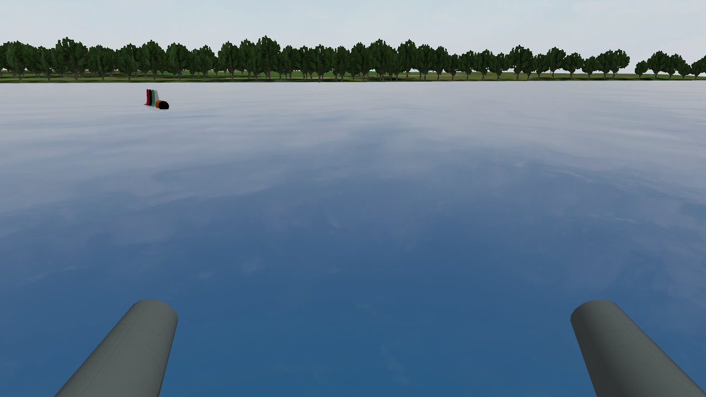

# MOOS与VRX单艇结果

MOOS任务1/1、19.08模拟秒，理想二维13.75秒；VRX同任务15.7秒，理想二维12.7秒。两平台及原例各自独立运行。

## 第三人称外部视角

独立实际场景取景，未发布推进指令。相机用于观察完整WAM-V与环境，没有接入规划和控制；这些画面与任务性能运行分别记录。

外部图均1600×900原生RGB，未裁切或补画；[相机位姿与图像来源](camera_views.json)。

## 艇载相机

原例实收1280×720 RGB8首帧；3秒零推力后左右各100 N运行8秒，采样位移6.093563239 m。

[最终指标](metrics.json)

[项目结果总览](../../README.md#5复现结果) · [运行指南](../../README.md#6运行指南)
