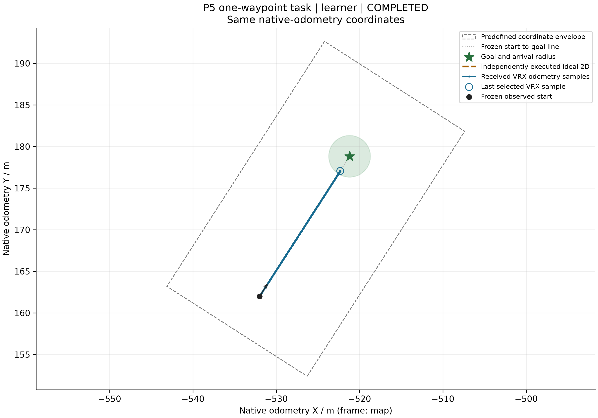
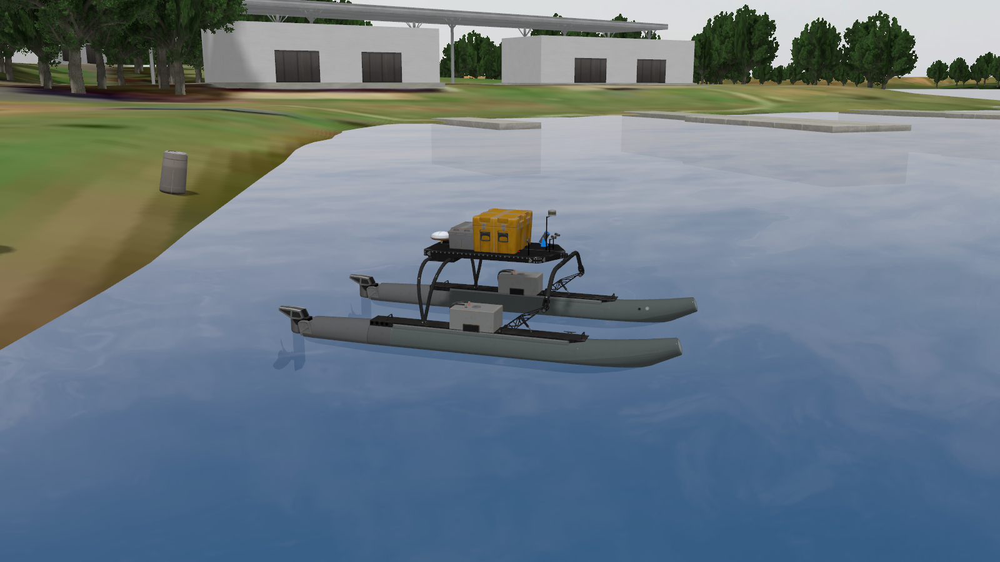
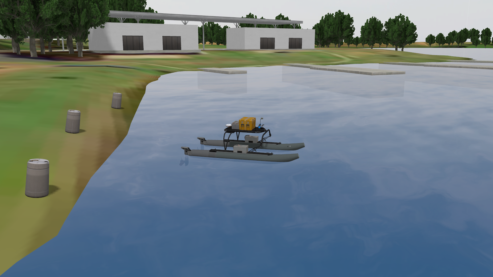
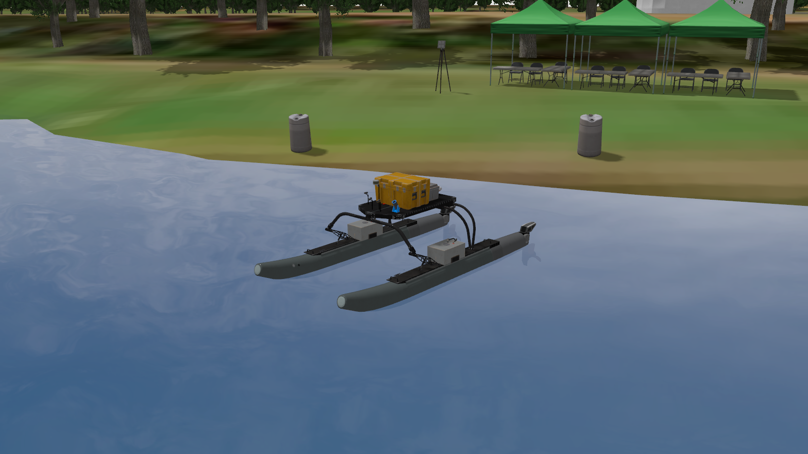

# P5｜单艇MOOS／VRX

本人MOOS1/1、19.08模拟秒；VRX配对15.7秒对理想二维12.7秒。原例原生位姿位移6.093563米，收到1280×720 RGB8帧。

[进度误差图](figures/VRX_progress_error.png) · [原例实收相机](figures/original_first_camera_frame.png)

[MOOS保存结果](raw/moos/result.json) · [VRX配对保存摘要](raw/vrx_pair/summary.json) · [原例位姿](raw/vrx_original/observations/model_pose.csv)

[相关学习笔记](../../docs/learning/06_moos_vrx.md) · [复现命令](../../README.md#6运行指南) · [结果口径](../../README.md#5复现结果) · [完整旧版归档](../../docs/sources.md)

## 第三人称外部视角

在相同官方悉尼水域与完整 WAM-V 场景中，新增独立静态观察相机，得到以下两张实际渲染。它们展示艇体与环境；该次运行没有发布推进指令，独立于之前本人完成的任务验收。

**近景：观察双浮筒、设备平台与艇体结构。**

**环境景：观察艇与岸线、水域和码头的空间关系。**

两张图均为原生相机流的第5帧，1600×900 RGB，未裁切、补画或改变像素。相机相对实测艇位的世界坐标偏移分别为 `(11,-3,3.4) m`、`(18,-6,5) m`，看向艇位上方0.8 m，水平视场1.05 rad；具体世界位姿、模拟时间、源码版本与像素SHA见[取景记录](raw/external_view/capture.json)。

**新增艇首斜侧方：从另一侧观察双浮筒、设备平台和岸边帐篷。**

本图来自单独的V03取景运行，同为1600×900原生RGB相机流第5帧。相机相对本次实测艇位的世界坐标偏移为 `(-2,12,4.5) m`，看向艇位上方0.8 m，水平视场1.05 rad；[该图来源记录](raw/external_view/capture_bowquarter.json) 与 [相机配置](raw/external_view/bowquarter_observer.sdf) 单独保留。没有发布推进指令，原两张图及原任务证据保持。

角度服务于可读性：低斜角近景看艇体，稍远视角看艇与环境。它不是规划算法算出的最佳朝向。原艇载相机首帧仍单独保留，用于证明原传感器图像通路。

观察相机仅为无碰撞、无可视实体的静态模型，不修改艇体或原世界文件。两份SDFormat为[近景配置](raw/external_view/detail_observer.sdf)、[环境景配置](raw/external_view/shoreline_observer.sdf)。配置中的绝对位姿属于本次运行；再次取景时，先从原生世界位姿读取实际艇位，再按上述世界偏移重算位置，以及朝向目标的俯仰和偏航，不能把旧坐标当作实时观测。
