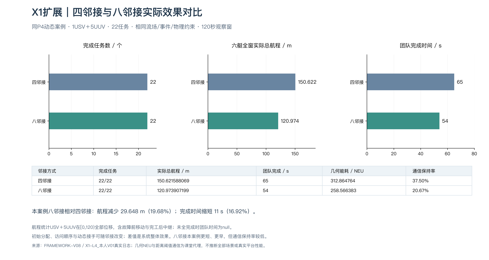

# X1｜四／八邻接融合

同P4动态场景，两组22/22；四邻接150.621588069m／65s，八邻接120.973907199m／54s。分配与顺序也随邻接变化。

[路线叠图](figures/routes.png) · [指标](metrics.json)

[相关学习笔记](../../docs/learning/01_path_planning.md) · [复现命令](../../docs/reproduction.md) · [结果口径](../../docs/results.md) · [完整旧版归档](../../docs/sources.md)
