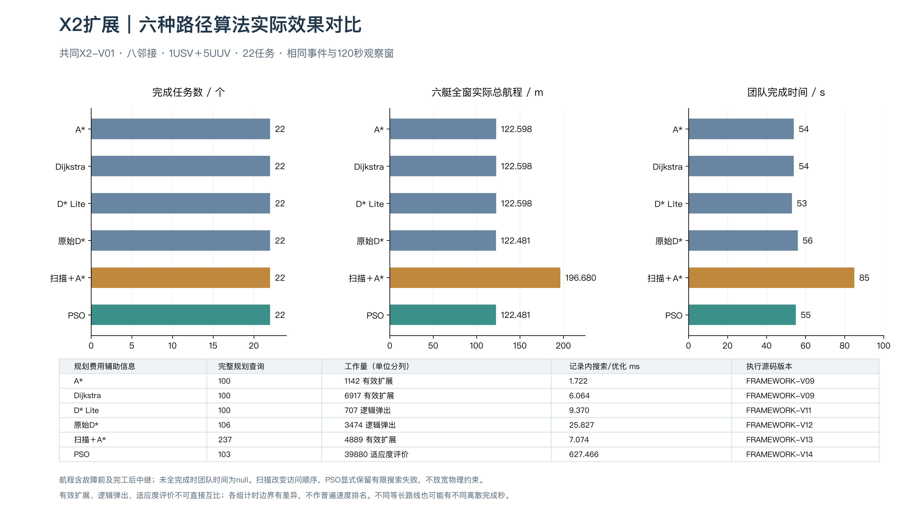
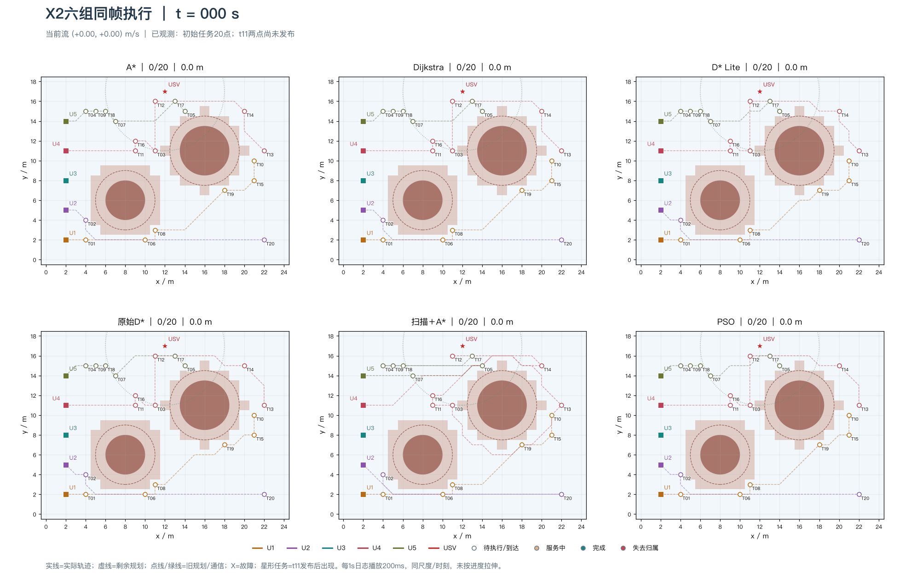

# X2｜六种路径方法

六组均完成22/22。指标统计六艇[0,120)实际移动，包含完工后中继；单案例不证明普遍排名。

[六组原始指标](metrics.json) · [A*精选保存结果](reference/Astar/结果.json) · [Dijkstra精选保存结果](reference/Dijkstra/结果.json)

当前精选包仅保留A*／Dijkstra的完整结果、查询与观测图，足以独立核查；六组完整动画在下方直接展示；其余四算法历史全日志保留于作者本地，当前精选包不包含。

[相关学习笔记](../../docs/learning/05_algorithm_comparison.md) · [复现命令](../../docs/reproduction.md) · [结果口径](../../docs/results.md) · [完整旧版归档](../../docs/sources.md)

## 六算法同帧回放

本图沿用原六组保存日志制作的动画，字节与交付基线相同，没有重跑模拟。
