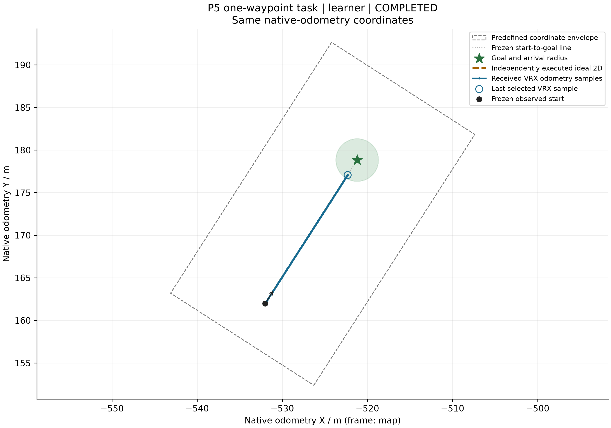
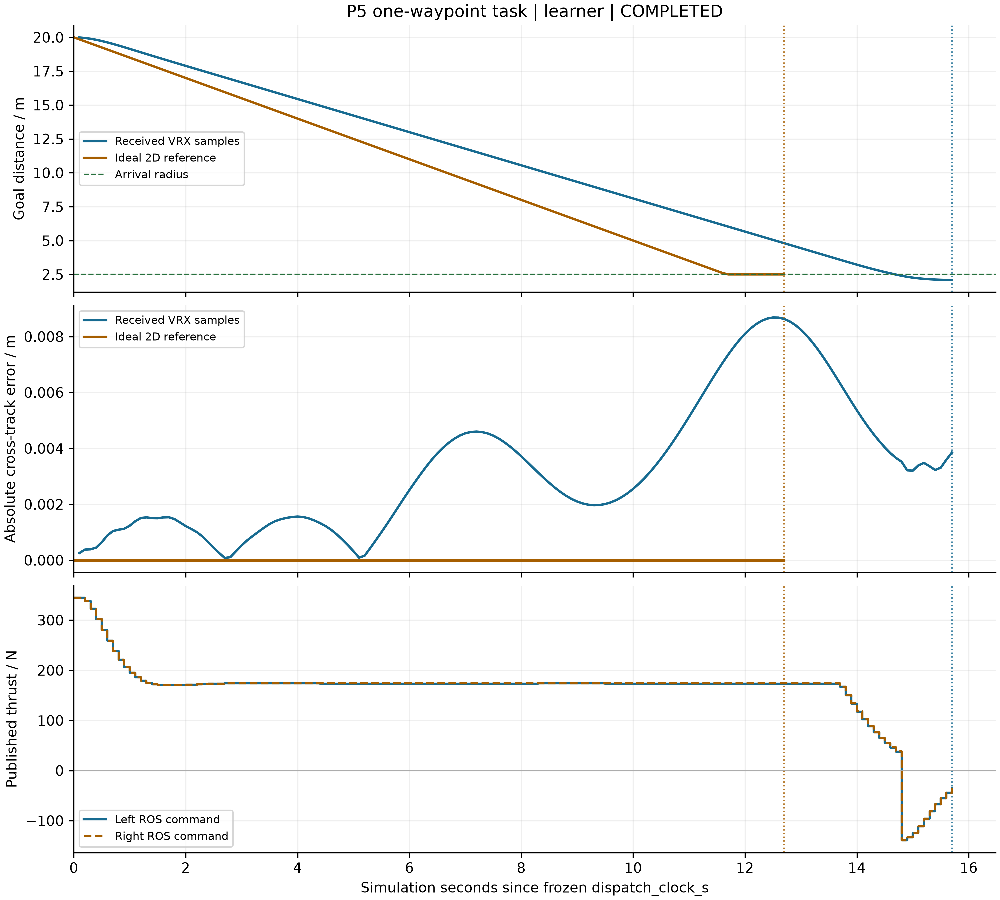
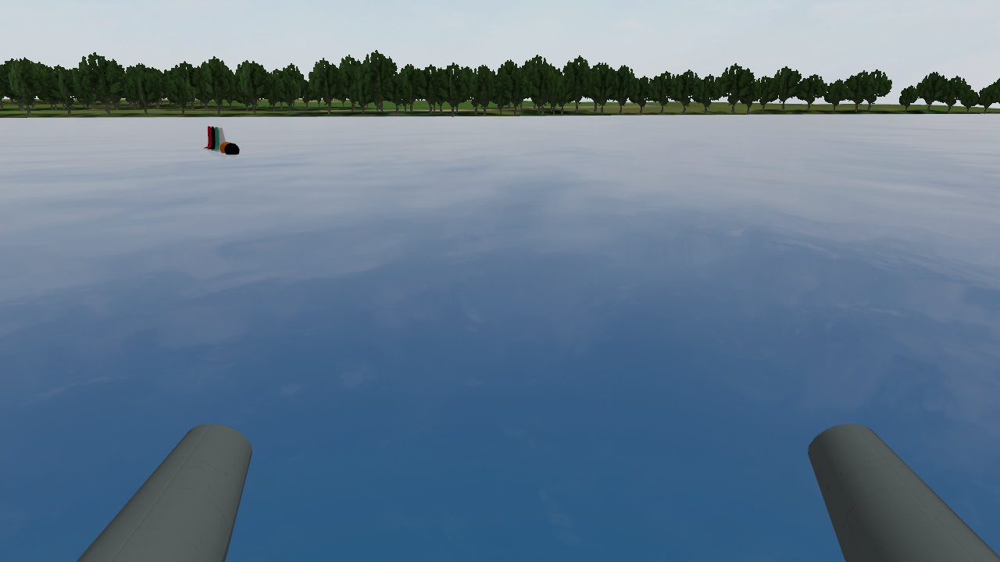

# P5平台接口与同任务真实结果

主案例采用本人保存的FRAMEWORK-V20运行，工程独立核查PASS，展示RENDERED_VERIFIED。MOOS、VRX原例与同任务分别执行，不把独立日志拼成统一仿真。

## VRX与理想二维同任务

VRX15.7秒、二维12.7秒；最大横向偏差0.008682m/约0，坐标包络违规均0。相同实际起点/朝向/前方20m目标、1.5m/s标称速度、2.5m半径、1秒保持和预算；指标剔除派发前及关停尾段，未完成保留null。只统计实际收到的原生里程计；ROS推力图是发布记录，不是平台能耗或接收确认。

## 官方原例的实际相机

此帧来自独立官方原例；左右各100N约8秒的原生艇体水平位移6.093563m。只做无损RGB8解码，原始header/data/SHA保留，不是图像生成或拼接场景。它与上面的航点任务不是同一次运行。

[本人原始运行总摘要](../vrx_runs/P5_本人VRX_V01/摘要.md) · [VRX独立核查](../checks/P5_本人VRX_V01_对照独立核查_V01/摘要.md) · [原例独立核查](../checks/P5_本人VRX_V01_原例独立核查_V01/摘要.md) · [MOOS本人核查](../checks/P5_本人V01_保存日志复核_V01/摘要.md)

MOOS教师保存航迹图另见[P5 MOOS展示](P5_教师V02_保存日志复核_V01/摘要.md)；本人MOOS独立运行已通过。所有原始数据保持，展示不重跑平台。本次不含实艇/真实水声/电池/连续碰撞安全验证。
